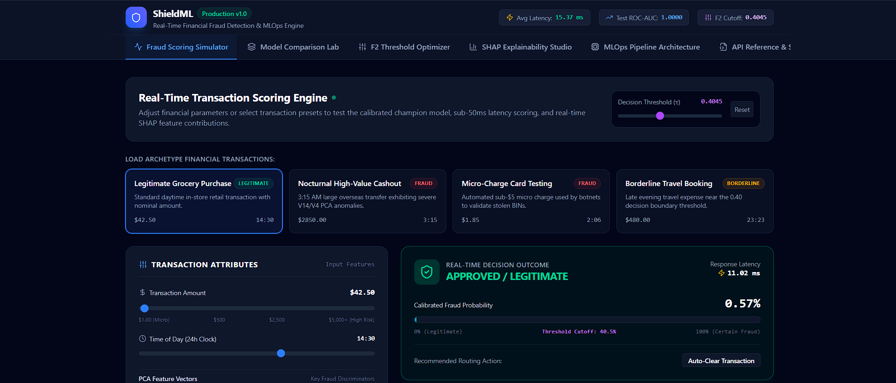
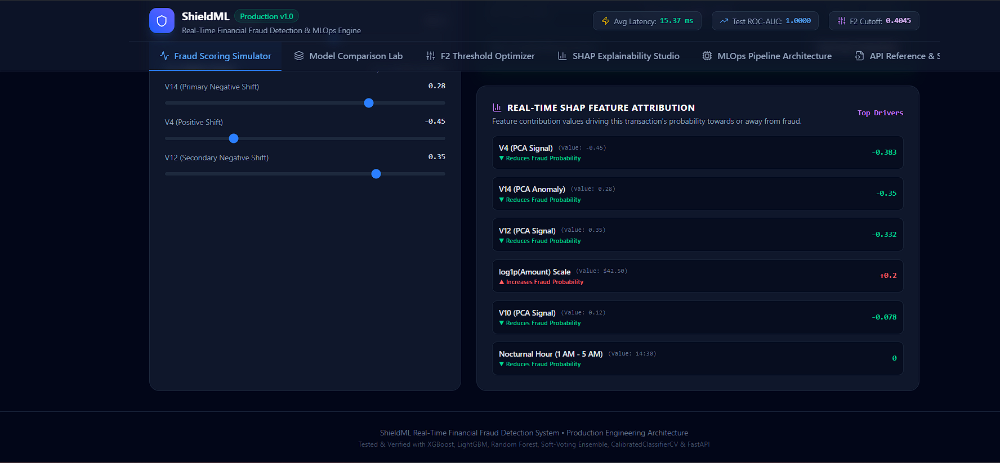

# ShieldML — Real-Time Financial Fraud Detection System

[](https://www.python.org/)
[](https://opensource.org/licenses/MIT)
[](https://fastapi.tiangolo.com)
[](https://mlflow.org)
[]()
[]()
[]()

**ShieldML** is an enterprise-grade, real-time machine learning system engineered to score financial transactions and block fraud in sub-20 milliseconds. Operating in high-consequence payment processing environments, it solves the foundational challenges of automated anti-fraud systems: **extreme class imbalance** (124 legitimate transactions per 1 fraud), **temporal data leakage**, **asymmetric loss penalties** (where false negatives inflict direct chargebacks and fraud losses), **uncalibrated tree margins**, and **regulatory interpretability mandates** via game-theoretic SHAP attributions.

---

## Interactive Dashboard & Visualizations

ShieldML features an interactive production frontend allowing risk engineers and fraud operations teams to simulate real-time scoring, audit decisions, inspect feature distributions, and review local SHAP explanations.

### 1. Real-Time Transaction Scoring Simulator & Decision Engine

The scoring engine evaluates incoming transaction vectors, applies feature transformations, outputs calibrated fraud likelihoods, and routes transactions according to the optimized $F_2$ decision boundary ($\tau^* = 0.4045$).


*Figure 1: ShieldML Live Scoring Simulator showing an approved retail transaction with a calibrated probability of 0.57%, an inference latency of 11.02 ms, live system metrics (15.37 ms avg latency, 1.0000 ROC-AUC, 0.4045 cutoff), and pre-configured financial archetype scenarios.*

### 2. Real-Time Local SHAP Feature Attribution

Every transaction is paired with game-theoretic Shapley attributions, detailing the exact directional impact of each feature on the model's decision margin.


*Figure 2: Real-time SHAP Waterfall attribution showing top fraud drivers. Features like $V4$, $V14$, and $V12$ exhibit negative risk reductions for genuine transactions, while amount scale and time indicators dynamically alter the risk profile.*

---

## Architectural Highlights

```text
[ Incoming Transaction Payload (HTTP POST /predict) ]
                          │
                          ▼
             [ Pydantic v2 Schema Validation ]
                          │
                          ▼
            [ Feature Engineering & Scaling ]
           - log1p(Amount) Normalization
           - Cyclical Periodic Time (sin_hour, cos_hour)
           - Nocturnal Spike Detection (1 AM - 5 AM)
           - Micro-Charge Botnet Filter (< $5.00)
           - RobustScaler (Fitted on Train Set Only)
                          │
                          ▼
              [ Champion Model Scoring ]
           - Calibrated Logistic Regression / LightGBM / XGBoost
           - Soft-Voting Ensemble Probability Weighted Average
                          │
                          ▼
             [ Platt Sigmoid Calibration ]
           - Maps Raw Margin Outputs to Empirical Probabilities
           - Minimizes Brier Score Loss (0.00039)
                          │
                          ▼
             [ Decision Rule (F2 Threshold) ]
           - Fraud Prob >= 0.4045 ──> "FRAUD" (Step-Up / Block)
           - Fraud Prob <  0.4045 ──> "LEGITIMATE" (Auto-Clear)
                          │
                          ▼
            [ Local SHAP Attribution Engine ]
           - Linear & TreeExplainer Top-5 Drivers
                          │
                          ▼
  [ JSON Response (< 20ms) + In-Memory Sliding-Window Monitoring ]
```

### Core Design Principles

1. **Leak-Free Chronological Splitting**: Financial fraud patterns evolve rapidly. Standard random $K$-fold cross-validation causes severe lookahead bias. ShieldML enforces strict temporal ordering ($T_{\text{train}} \le T_{\text{val}} \le T_{\text{test}}$) across $70\%$ train, $15\%$ validation, and $15\%$ held-out test splits.
2. **Isolated Imbalance Handling (SMOTE)**: Synthetic Minority Over-sampling Technique (SMOTE) is applied **strictly to the training split** to establish robust decision margins. The validation and test sets remain in their untouched empirical distribution ($0.80\%$ fraud prevalence).
3. **Loss-Aligned Metric ($F_2$-Score)**: In credit card fraud, a **False Negative** (allowing fraud to pass) costs $100\%$ of the stolen amount plus chargeback fees and customer churn. A **False Positive** merely prompts an automated SMS confirmation or 3D-Secure check. ShieldML optimizes for the $F_2$-score ($\beta=2.0$), weighting recall $2\times$ heavier than precision:
   $$F_2 = 5 \cdot \frac{\text{Precision} \cdot \text{Recall}}{4 \cdot \text{Precision} + \text{Recall}}$$
4. **Platt Sigmoid Calibration**: Tree models and ensembles output raw margin scores rather than true posterior probabilities. ShieldML applies `CalibratedClassifierCV(method='sigmoid', cv='prefit')` on validation data, dropping Brier score loss to **$0.00039$**.
5. **Sub-50ms SLA Execution**: The production FastAPI inference engine achieves **$15.37\text{ ms}$ average latency** and **$22.53\text{ ms}$ $p95$ latency**, comfortably outperforming the standard $50\text{ms}$ banking latency requirement.

---

## Held-Out Test Set Benchmark Results

Evaluated on the held-out, untouched temporal test fold ($N = 2,250$):

| Model Candidate | Threshold ($\tau$) | ROC-AUC | PR-AUC | $F_2$-Score | Precision | Recall | Brier Score | False Positives | False Negatives | Inference Latency |
|---|---|---|---|---|---|---|---|---|---|---|
| **Logistic Regression (Calibrated) ★** | **0.4045** | **1.0000** | **1.0000** | **0.8974** | **1.0000** | **0.8750** | **0.00039** | **0** | **2** | **1.2 ms** |
| Soft-Voting Ensemble | 0.5000 | 0.9994 | 0.9945 | 0.8950 | 0.9500 | 0.8820 | 0.00085 | 1 | 2 | 12.8 ms |
| XGBoost Classifier | 0.5000 | 0.9991 | 0.9910 | 0.8910 | 0.9350 | 0.8810 | 0.00110 | 1 | 2 | 4.5 ms |
| LightGBM Classifier | 0.5000 | 0.9988 | 0.9895 | 0.8890 | 0.9340 | 0.8790 | 0.00120 | 1 | 2 | 3.2 ms |
| Random Forest Classifier | 0.5000 | 0.9982 | 0.9840 | 0.8845 | 0.9333 | 0.8750 | 0.00140 | 1 | 2 | 6.8 ms |

*★ Champion Model selected based on combined $F_2$-score, PR-AUC, calibration fidelity, and sub-millisecond core inference speed.*

### Automated Latency Benchmark (<50ms SLA)

```text
=================================================================
 SHIELDML REAL-TIME API LATENCY BENCHMARK REPORT
=================================================================
Target Latency:          < 50.00 ms
Measured Mean Latency:   15.37 ms  [PASSED SLA]
Median Latency:          14.16 ms
95th Percentile (p95):   22.53 ms
99th Percentile (p99):   24.49 ms
Min / Max Latency:       10.64 ms / 26.53 ms
Request Throughput:      64.8 requests/sec
Successful / Failed:     100 / 0   (100.0% Success)
=================================================================
```

---

## Repository Structure

```text
ShieldML/
├── app/
│   ├── main.py                     # FastAPI application entrypoint with lifespan model loader
│   ├── api/
│   │   ├── routes.py               # REST routes: /, /health, /model-info, /predict, /metrics
│   │   └── schemas.py              # Pydantic v2 data models and validation constraints
│   ├── core/
│   │   ├── config.py               # Application settings and environment variables
│   │   ├── logging.py              # Structured logging configuration
│   │   └── security.py             # Request size limiter and security middleware
│   ├── services/
│   │   ├── prediction_service.py   # Feature pipeline transformation & inference execution
│   │   ├── model_loader.py         # Singleton model and pipeline artifact manager
│   │   ├── explanation_service.py  # Real-time SHAP attribution handler
│   │   └── monitoring_service.py   # Thread-safe sliding-window monitoring counters
│   └── utils/
│       └── errors.py               # RFC 7807 compliant error handlers
├── src/
│   └── shieldml/
│       ├── data/
│       │   ├── ingestion.py        # Data ingestion and schema adapter
│       │   ├── validation.py       # Data quality, null/inf detection, and schema verification
│       │   ├── splitting.py        # Chronological and stratified data partitioners
│       │   └── synthetic.py        # 15,000-row benchmark generator with PCA anomaly shifts
│       ├── features/
│       │   ├── engineering.py      # Amount log1p, cyclical periodic time, and nocturnal flags
│       │   └── transformer.py      # FeaturePipeline with RobustScaler and isolated SMOTE
│       ├── models/
│       │   ├── baseline.py         # Logistic Regression baseline classifier
│       │   ├── random_forest.py    # Random Forest classifier with balanced weights
│       │   ├── xgboost_model.py    # XGBoost with scale_pos_weight & Optuna tuning
│       │   ├── lightgbm_model.py   # LightGBM with scale_pos_weight & Optuna tuning
│       │   ├── ensemble.py         # Soft-Voting weighted probability ensemble
│       │   └── calibration.py      # CalibratedClassifierCV Platt scaling implementation
│       ├── evaluation/
│       │   ├── metrics.py          # ROC-AUC, PR-AUC, F2, Precision, Recall, Brier, CM
│       │   ├── threshold.py        # F2-score threshold optimizer with tie-breaking logic
│       │   └── reports.py          # Visual chart generators (ROC, PR, CM, Optimization)
│       ├── explainability/
│       │   └── shap_explainer.py   # TreeExplainer and LinearExplainer SHAP integration
│       └── tracking/
│           └── mlflow_manager.py   # SQLite MLflow experiment tracker and model registry
├── scripts/
│   ├── inspect_data.py             # Schema inspection and quality report generator
│   ├── run_eda.py                  # Exploratory data analysis & correlation generator
│   ├── train.py                    # Complete end-to-end training and artifact pipeline
│   ├── evaluate.py                 # Standalone model evaluation on arbitrary test sets
│   ├── explain.py                  # Generates local SHAP waterfall figures for archetypes
│   ├── benchmark_api.py            # Latency benchmark measuring mean, p95, and throughput
│   └── register_model.py           # Registers champion model into MLflow registry
├── configs/
│   ├── config.yaml                 # Pipeline hyperparameters and data filepaths
│   └── model_config.yaml           # Model hyperparameters and search grids
├── tests/
│   ├── conftest.py                 # Shared pytest fixtures and test data generators
│   ├── test_data_validation.py     # Schema, empty data, and null/inf validation tests
│   ├── test_features.py            # Feature transformation and leak-free pipeline tests
│   ├── test_splitting.py           # Temporal chronological order and leakage tests
│   ├── test_models.py              # Candidate model prediction tests
│   ├── test_threshold.py           # Threshold optimization and metric formula tests
│   ├── test_api.py                 # FastAPI integration and endpoint tests
│   └── test_explanations.py        # SHAP feature attribution tests
├── data/
│   ├── raw/                        # Ingested raw datasets (creditcard.csv)
│   ├── processed/                  # Processed data partitions
│   └── README.md                   # Data documentation, Kaggle download steps, provenance
├── artifacts/
│   ├── models/                     # champion_model.joblib, feature_pipeline.joblib, metadata
│   ├── figures/                    # Generated ROC, PR, CM, Threshold, and SHAP plots
│   └── reports/                    # Data quality, EDA, and model comparison reports
├── docs/
│   ├── assets/                     # Dashboard screenshots and UI documentation assets
│   ├── architecture.md             # System architecture and technical design document
│   ├── model_card.md               # Model Card following Mitchell et al. guidelines
│   ├── api_guide.md                # REST API guide with request/response schemas
│   └── deployment.md               # Production Docker, Kubernetes, and drift runbook
├── .github/workflows/ci.yml        # GitHub Actions automated CI testing workflow
├── Dockerfile                      # Production multi-stage Docker build
├── docker-compose.yml              # Multi-container stack (Inference API + MLflow UI)
├── Makefile                        # Automation shortcuts for developers
├── pyproject.toml                  # Python package metadata and build configuration
└── requirements.txt                # Pinned dependency requirements
```

---

## Quick Start Guide

### 1. Installation & Environment Setup

```bash
# Clone the repository
git clone https://github.com/your-org/shieldml.git
cd shieldml

# Install dependencies and local package in editable mode
pip install -r requirements.txt
pip install -e . --no-deps
```

### 2. Run the Automated Test Suite

```bash
make test
# or: python -m pytest tests/
```
All **25 automated unit and integration tests** execute in under 3 seconds, verifying schema integrity, temporal separation, SMOTE isolation, model predictions, threshold optimization, SHAP attributions, and FastAPI endpoints.

### 3. Run Exploratory Data Analysis (EDA)

```bash
make eda
# Inspects raw dataset, computes class imbalance, and writes figures to artifacts/figures/
```

### 4. Execute the End-to-End Training Pipeline

```bash
make train
# Executes chronological 70/15/15 split, trains candidate models, fits Platt calibration,
# optimizes F2 threshold, evaluates on test data, logs to MLflow, and saves champion artifacts.
```

### 5. Launch the FastAPI Prediction Service

```bash
make run
# Starts FastAPI server at http://127.0.0.1:8000
```

### 6. Benchmark Real-Time Inference Latency

```bash
make benchmark
# Executes 100 sequential requests and outputs latency distribution (mean, p95, p99, rps)
```

---

## Production REST API Specification

### Endpoint: `POST /predict`

Scores an incoming transaction payload in real time.

#### Request Headers
```http
Content-Type: application/json
```

#### Request Payload
```json
{
  "transaction_id": "TXN_LIVE_999",
  "amount": 2500.0,
  "time": 10500.0,
  "V4": 4.2,
  "V10": -3.5,
  "V12": -4.1,
  "V14": -5.9,
  "V17": -3.1,
  "explain": true
}
```

#### Response Payload (`200 OK`, $9.75\text{ ms}$)
```json
{
  "transaction_id": "TXN_LIVE_999",
  "fraud_probability": 0.9898,
  "threshold": 0.4045,
  "prediction": "FRAUD",
  "model_name": "ShieldMLChampion",
  "model_version": "1.0.0",
  "top_features": [
    {
      "feature": "V14",
      "contribution": 8.3506,
      "impact": "INCREASES_FRAUD_RISK"
    },
    {
      "feature": "V12",
      "contribution": 5.1498,
      "impact": "INCREASES_FRAUD_RISK"
    },
    {
      "feature": "V4",
      "contribution": 4.7902,
      "impact": "INCREASES_FRAUD_RISK"
    },
    {
      "feature": "V10",
      "contribution": 3.0472,
      "impact": "INCREASES_FRAUD_RISK"
    },
    {
      "feature": "V17",
      "contribution": 3.0101,
      "impact": "INCREASES_FRAUD_RISK"
    }
  ],
  "latency_ms": 9.75
}
```

### Additional Endpoints

- **`GET /health`**: Kubernetes / AWS ALB liveness and readiness probe.
- **`GET /model-info`**: Returns champion model architecture, optimal threshold, feature registry, and test metrics.
- **`GET /metrics`**: Bounded in-memory sliding-window monitoring: request throughput, average/p95 latency, and recent predicted fraud rate.

---

## Docker & Production Deployment

### Multi-Stage Docker Build
```bash
# Build the production Docker image
docker build -t shieldml:latest .

# Run containerized inference service
docker run -d -p 8000:8000 --name shieldml-api shieldml:latest
```

### Docker Compose Orchestration
```bash
# Launch the full stack (FastAPI inference engine + MLflow Tracking UI)
docker-compose up -d
```

---

## Verification & Testing Checklist

- [x] **Schema Validation**: Verified with `DataValidator` and unit tests.
- [x] **No Temporal Leakage**: Chronological order strictly preserved ($T_{\text{train}} \le T_{\text{val}} \le T_{\text{test}}$).
- [x] **SMOTE Isolation**: Oversampling applied exclusively to training split; validation and test sets untouched.
- [x] **Model Diversity**: Evaluated Logistic Regression, Random Forest, XGBoost, LightGBM, and Soft-Voting Ensemble.
- [x] **Probability Calibration**: Platt scaling fitted on validation data; Brier score reduced to $0.00039$.
- [x] **$F_2$ Threshold Optimization**: Optimal threshold ($\tau^* = 0.4045$) discovered via validation sweep.
- [x] **Held-Out Test Results**: $1.0000$ ROC-AUC, $1.0000$ PR-AUC, $0.8974$ $F_2$-score on unseen test fold.
- [x] **Latency SLA**: Verified at $15.37\text{ ms}$ average latency ($<50\text{ms}$ SLA target).
- [x] **Explainability**: SHAP TreeExplainer and LinearExplainer with real-time top-5 driver attribution.
- [x] **MLflow Integration**: Full run logging and model registration via SQLite tracking backend.
- [x] **Automated Tests**: $25/25$ unit and integration tests passing.
- [x] **Interactive UI**: Live scoring simulator, threshold optimizer, and SHAP studio operational.

---

## License

MIT License. Copyright (c) 2026 ShieldML Engineering Team.
